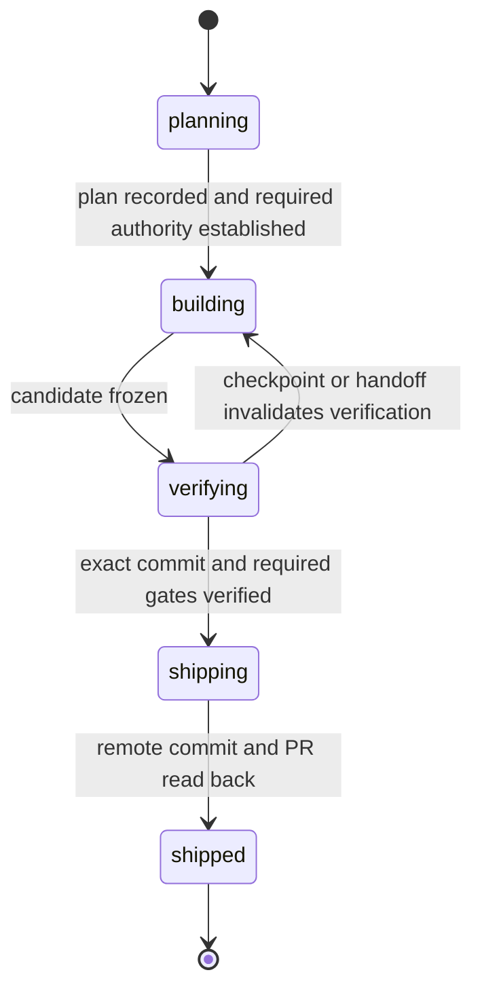

# Cross-host plan → build → verify → ship

Date: 2026-10-24

Status: implementation preview; end-to-end release evidence required

Confidence: sand. The runtime implements the component boundaries and managed workflow. Actual host interoperability, interruption recovery, and installed-artifact behavior require retained proof against the release acceptance scenarios.

Publication target: `all-source-os/allstack`

## Complete human job

A developer plans a repository change in Codex CLI, hands it to Claude Code for implementation, interrupts that session, and resumes in Codex CLI. The resumed host reconstructs the plan and changed workspace, runs the repository's required verification, and publishes the verified commit as one pull request. No transcript copying or repeated uncertain publication is required.

The reverse host order must work too. This release supports sequential host changes on one machine. It does not claim cross-machine transport, simultaneous editing, automatic merge, deployment, or recovery of an agent's hidden reasoning.

Ship completes when the exact verified commit exists on the expected remote feature branch and an open pull request points to it. Chronis task completion follows that destination check. A merge is not required for this task to finish.

## Product and scope

Allstack is a public, local-first workflow toolkit. Its initial surface is four methods, a small Rust coordinator and CLI, and two host adapters. Existing hosts perform model work; Allstack does not implement another model execution loop.

The developer supplies their coding host and repository. AllSource, Chronis, and Prime work locally without a hosted account. Remote storage, team access, browser QA, treg, AllFrame services, and autoresearch evaluation are extension points rather than prerequisites for the first release.

Repository guidance remains authoritative for branch creation, commits, pushes, approvals, tests, and document layout. Starting a workflow does not grant every permission it might eventually need. An explicit publish request can authorize publication; a missing permission must be requested against the prepared change.

## Alternatives considered

| Approach | Benefit | Limitation |
| --- | --- | --- |
| New toolkit over existing ecosystem primitives | Explicit state ownership and portable handoff contracts | Requires integration and recovery work |
| Direct gstack fork | Existing catalog and behavior available earlier | Carries upstream structure and maintenance obligations |
| Hosted agent platform | Shared access and centralized execution | Adds infrastructure before the local workflow is proven |

Choose a new toolkit. Reuse individual upstream methods only when their license and behavior fit. Keep upstream attribution with every reused portion. The workflow methods and design prose are original.

## Ownership and topology

| Concern | Authority | Derived or cached view |
| --- | --- | --- |
| Workflow stage, handoff epoch, operation outcome | Allstack domain events in AllSource Core | CLI status and host context bundle |
| Task status, dependencies, task claimant | Chronis task stream | Run stores task reference; adapter reads back claimant and status |
| Decisions and incident recall | Embedded Prime delivery nodes with source references | Local lexical matching; never permission or execution state |
| Files and commits | Git plus retained workspace snapshot | Content manifests and digests |
| Remote branch and pull request | Git remote and forge | Publication receipts recording read-back evidence |
| Current authority to act | Explicit user instruction and trusted host policy | Scoped operation authorization record |

Use existing component APIs. Do not open their WAL or Parquet files directly. Separate namespaces and component-owned stores are acceptable: owning different facts is different from maintaining competing copies of the same fact.

Each CLI invocation is the coordinator for its operation. It acquires an exclusive kernel lock on `.allstack/coordinator.lock` before opening the mutable store, holds it through component updates, and releases it on shutdown. Another command fails as busy instead of competing with an active mutation. The runtime embeds AllSource Core 0.26.1 with WAL synchronization on each event; run events do not live in a parallel JSON or SQLite database. Reads validate the retained revision chain and transition contracts before using a run.

This preview chooses a command-scoped lock instead of the original persistent-daemon topology. Authenticated local IPC is therefore absent. Epoch checks and the locked coordinator fence managed operations on the sequential same-machine path. An epoch is not a secret or a host identity credential; native commands outside Allstack are not sandboxed by it. A future remote or multi-user service would need an authenticated authority boundary before expanding this claim.

Keep domain types and transitions pure. Application services depend on storage, task, recall, process, and forge ports. Infrastructure implements those ports; the CLI is the presentation edge. Composition binds the adapters. Import-boundary checks keep application services independent of infrastructure and presentation.

Coordinator startup, ownership, shutdown, crash recovery, and store locking require executable proof. Two coordinators must not open the same mutable run store. No implicit remote fallback is allowed. `doctor` reports actual local paths, durability mode, coordinator model, Prime scope, and probed tool versions. Version probes do not prove authentication or successful host execution.

## User interface

The CLI returns JSON. The [CLI guide](../reference/cli.md) specifies prerequisites, authority flags, frozen policy, and recovery. An uninterrupted example uses the current epoch returned by each handoff:

```text
allstack doctor
allstack start --request docs/requests/example.md --policy workflows/verification.toml --host codex --allow-commit --allow-publish
allstack plan <run> --epoch 1
allstack status <run>
allstack handoff <run> --epoch 1 --to claude-code
allstack resume <run> --epoch 2
allstack build <run> --epoch 2
allstack handoff <run> --epoch 2 --to codex
allstack resume <run> --epoch 3
allstack verify <run> --epoch 3 --message "feat(example): implement accepted change"
allstack ship <run> --epoch 3 --title "feat(example): implement accepted change"
```

Starting a run binds an existing authorized feature branch. No branch is created implicitly. Commit and publish flags may be set only when trusted user instructions already grant that authority. Host adapters invoke real `codex exec` and `claude --print` commands with their ordinary permission modes; no permission-bypass flags are used. Host skill documents explain the managed boundary. MCP is a possible later transport, not a preview dependency.

Successful operations return serialized run state; failures return actionable errors and leave durable pending operation state where reconciliation is required. A zero-test invocation cannot satisfy a test requirement.

## Workflow state

The durable stage sequence is:



Each run records its active host, workspace epoch, revision, and optional pending operation. A handoff changes host and epoch; handing off a verifying run returns it to building and discards its verification. Pending operations block unrelated execution until reconciled. Richer disposition and terminal-cancellation contracts remain future work.

The workflow definition, plan/build method text, and verification policy are frozen by digest. Candidate content, exact commit, and the selected environment fingerprint bind final evidence. Changed inputs block shipping; checkpoint and handoff clear prior verification. A new revision records transitions without overwriting old results. A host cannot advance a stage by writing a favorable summary.

### Plan

Recall relevant Prime decisions and incidents, then open their sources before treating them as requirements. Read repository guidance, branch/PR state, actual working tree, and applicable gates. Bind the request, acceptance criteria, repository identity, workflow version, verification policy, and intended publication target into a plan revision.

Create or associate one Chronis task using its public interface. Record its reference in the run. Claim it and read back the actual claimant before proceeding. A Chronis claim is task bookkeeping, not an execution lock or proof of human approval.

Persist and index the plan in the target repository's existing docs layout. The plan identifies the complete human flow, required capabilities, and unresolved permissions. The developer's supplied instruction may already establish authority; do not introduce a redundant approval prompt.

### Build

The active host edits a run-owned detached worktree. It inherits the exact plan and retained input snapshot, then implements the complete accepted change. It never commits unrelated files or amends another person's history. Source edits outside the managed worktree are outside Allstack's supported execution boundary.

Each change attempt links its input revision, workspace epoch, modified-file manifest, and verification evidence. Build failures return to this stage. Required fixture and repository setup is verified on disk before execution; a worktree is not assumed ready because its directory exists.

### Verify

Freeze the candidate and map acceptance criteria to concrete checks. Run repository-required checks and the real end-to-end flow. Test results include whether execution occurred and how many checks or cases were exercised when the tool exposes those facts. Missing execution evidence remains inconclusive.

After authorized commit creation or collapse, run the required final gates against that exact commit. Include workflow digest, plan revision, gate configuration, relevant toolchain/lockfile/environment fingerprints, workspace digest, command result, and retained artifact digests in each receipt. Execution must not leave the checkout dirty. A new commit SHA requires new final verification.

Before publication, re-check branch liveness, current ownership, remote target, required checks, and source cleanliness. Relevant upstream or policy changes can invalidate an older verification. Commit creation requires existing user authorization or a concrete permission request.

### Ship

Prepare one commit on an authorized live feature branch, one PR description, and indexed documentation. Reuse the run's existing open PR. Do not push the trunk, bypass hooks, or rewrite other authors' commits. An owned unmerged branch may be amended under the repository's policy; then final gates run again.

Record publication intent before invoking the forge. Push the exact verified commit to the matching remote branch with the required lease semantics. Confirm the remote ref independently, open or update the one PR, and read back its head SHA. If a response is lost, inspect the destination before deciding what remains to do. Do not issue a second create or push solely because the receipt is missing.

Only after remote commit and PR head match does the run record `shipped`. Complete the associated Chronis task, read back its status, and index an outcome summary in Prime. These are separate component writes. Failure to update Chronis or Prime leaves explicit reconciliation work; it must not repeat publication.

## Handoff and workspace recovery

The first release makes cross-host a sequential transfer of control. It does not pass an active conversation or share a mutable checkout between hosts.

1. Stop admission of new managed actions for the outgoing host. Wait for owned operations to finish, or mark unresolved external operations unknown.
2. Retain an immutable workspace snapshot: base commit, tracked modifications, file modes, and content digests. New intended files require explicit `git add -- <path>` before capture; untracked files block the snapshot. Verify the source manifest before and after capture; concurrent changes invalidate the snapshot. Reject symlinks, path escapes, and recognized sensitive filenames. Enforce limits of 4 MiB per file, 64 MiB total, and 10,000 files. Filename checks do not detect every secret.
3. Store snapshot bytes in a private local content-addressed artifact directory. Append a handoff receipt only after every referenced object is durable and readable. The run event records references and hashes, not source file bodies or raw transcripts.
4. Increment the run's ownership epoch under the store lock. Allstack rejects managed transitions using the old epoch. The incoming context contains the new epoch; there is no bearer capability or IPC identity exchange in this preview.
5. Restore the retained snapshot into a different detached worktree. Verify repository identity, base commit availability, file containment, manifest completeness, modes, setup, and resulting content digests before admitting mutations.
6. Reconcile Chronis ownership through its own API, then read it back. If transfer is incomplete, report it explicitly. Do not steal another active task claim. The run can remain readable while ownership repair blocks execution.
7. Deliver a context bundle: request, plan revision, task reference, stage, evidence references, unresolved operations, repository policy, and active epoch. Prime recall adds source-linked context after authoritative state is loaded.

Stale hosts may still edit their old worktree using their native tools. Those edits do not alter the immutable snapshot or the new host's worktree and cannot authorize managed publication. Host adapters cannot promise to block every action taken outside Allstack.

If the outgoing host crashes before a handoff, recover from the last complete retained checkpoint. Newer edits are recoverable only after inspecting and freezing the abandoned worktree; never claim they were already persisted. Lost or corrupt artifact bytes block continuation rather than reconstructing source from model memory.

## Run events and consistency

Use a distinct versioned namespace such as `allstack.workflow.v1.*`. The existing internal `agent_run.v1` contract is closed and lacks workspace, fencing, and publication fields. Do not silently add fields to it or represent it as a released SDK execution service.

A workflow event binds schema version, run ID, operation ID, sequence, predecessor, workflow digest, workspace/repository scope, host epoch, and event-specific validated fields. Conditional transition checks and idempotent operation recovery happen at the coordinator boundary. Configure durable acknowledgement, validate retained history, and never infer order from timestamps alone.

The append adapter compares the expected run revision under the exclusive store lock, writes through AllSource's embedded API, and reads back the resulting history. Revision order, predecessor hashes, operation identity, and transition validation guard replay. Locking is the local compare/write boundary; the embedded ingest interface is not an external compare-and-swap service. Missing order, partial retained history, and mismatched duplicate operations fail closed. The preview does not configure run-history retention or cross-machine writers.

Chronis and Prime do not participate in a distributed transaction. Record intended component updates as durable workflow operations and reconcile them through their supported APIs. Chronis task recovery searches the exact run-linked task title and refuses duplicate matches; claims are read back with the expected host/epoch actor. Prime delivery records use a run/phase key and source reference. Recall performs local lexical matching over embedded graph nodes, not vector search. Prime is context only; it cannot certify execution or publication. A Prime open failure degrades recall without hiding authoritative run status. Plan indexing remains marked `memory_pending` until `recover` reconciles it; shipping reconciles outcome metadata before terminal completion. An unconfirmed Chronis claim blocks managed work.

## Authority and evidence

Recorded events describe observations. A Chronis `approve`, a Prime node, an agent-written hash, or `change.approved` does not independently establish human authority.

The preview records `allow_commit` and `allow_publish` supplied at run start, together with repository, branch, remote, request, workflow, and policy scope. These flags rely on the trusted caller to obtain user permission; they are not authenticated approval records. Repository and host policy may further restrict operations. A richer externally verifiable authorization binding is future work.

Guarantees apply to actions invoked through Allstack's managed boundary. Hooks and host instructions provide additional guardrails with explicit coverage limits. Documentation must not describe them as a sandbox or treat a bypassable check as mandatory enforcement.

## Processes, artifacts, and local operation

A process Allstack spawns must be owned for its whole lifetime by a supervisor that can kill and reap it. The guardian observes a pipe owned by the caller; caller death revokes child lifetime. Managed work has a maximum 290-second execution allowance with cleanup inside the 300-second ceiling. Timeouts terminate and reap the owned process group and preserve diagnostic evidence. Lost acknowledgements of external side effects remain unknown. Process-level death tests are required to establish this behavior.

Run only one build or compile gate on the machine at a time. Detect external competing builds and report contention rather than killing other sessions. Local queueing has a bounded deadline. These requirements need actual process-level tests, including supervisor death, rather than only mocked subprocess calls.

Keep `.allstack/` runtime stores, credentials, worktrees, and raw evidence out of Git. Private artifacts remain local and are referenced by digest. Public delivery documents contain intentionally selected evidence with project-relative references; they must not expose private absolute paths, account data, source snapshots, or secrets. Cross-machine export/import is outside this release.

## Repository shape

```text
workflows/delivery.toml       versioned workflow and method references
workflows/methods/            frozen plan and build instructions
docs/plans/                  design and implementation decisions
docs/reference/              contracts and release acceptance
src/domain.rs                pure run types and transition validation
src/application/             workflow orchestration and ports
src/infrastructure/          AllSource, Chronis, Prime, host, Git, and process adapters
src/presentation.rs          CLI commands and composition
hosts/                       host skill guidance
tests/                       executable source and integration contracts
fixtures/                    journey definitions requiring real host execution
```

Source installation is available for preview validation. Publish checksummed release binaries and versioned host packages only after the complete supported flow passes. License original code under Apache-2.0 and retain separate notices for any future upstream reuse.

## Implementation sequence

1. Freeze the versioned workflow, run reducer, append port, evidence schema, and host capability contract using synthetic fixtures. Prove actual AllSource durability, exclusivity, and sequence recovery.
2. Implement local coordinator and CLI, explicit storage setup, operation recovery, and component adapters. Prove that Chronis/Prime partial updates reconcile without duplicating external work.
3. Implement plan/build/verify/ship methods and actual Codex CLI and Claude Code adapters. Prove immutable snapshot handoff in both directions and stale-host isolation.
4. Complete real Git/forge publication, final-commit verification, process cleanup, interruption scenarios, documentation, and fresh installation. Validate exact released artifacts rather than only source.

These are dependencies within one complete first release. None is a substitute for end-to-end acceptance. Expand the catalog after the first workflow meets [release acceptance](../reference/release-acceptance.md).

## Evidence and current limits

The preview pins AllSource Core 0.26.1 with embedded and Prime features. Source inspection establishes the adapter contracts, not installed-version compatibility or successful authenticated host journeys:

- [AllSource embedded engine](https://github.com/all-source-os/all-source/blob/main/apps/core/src/embedded/core.rs) exposes store lifecycle and query/ingest operations. Its public embedded `ingest` signature does not itself establish the expected-revision append contract required here.
- [Chronis claim implementation](https://github.com/all-source-os/all-source/blob/main/apps/chronis/src/infrastructure/core_task_repo.rs) reads current task state and appends `workflow.claimed`; [projection](https://github.com/all-source-os/all-source/blob/main/apps/chronis/src/infrastructure/projection.rs) applies the first claim while open. This is not a run fencing or authenticated authority-transfer service.
- [Prime](https://github.com/all-source-os/all-source/tree/main/apps/prime-mcp) provides graph, recall, history, and export primitives. Current tool availability and storage scope must be probed at setup.
- [Existing agent-run evidence contract](https://github.com/all-source-os/all-source/blob/main/docs/plans/2026-09-27-agent-run-evidence-contract.md) describes internal capture/read behavior and explicitly leaves public boundaries and execution wrappers open.
- [gstack](https://github.com/garrytan/gstack) supplies workflow reference material. Individual future reuse requires applicable notices.

Source URLs track upstream and may change. Retain tested contract fingerprints and exact installed versions in release evidence. The implementation currently targets sequential hosts on one Unix machine, a `github.com` remote, and Cargo/nextest test execution summaries. It does not provide cross-machine transport, a host sandbox, authenticated IPC, vector recall, or automatic merge/deployment. Fixture definitions intentionally await actual host journeys. Acceptance claims remain open until retained execution evidence establishes them.
